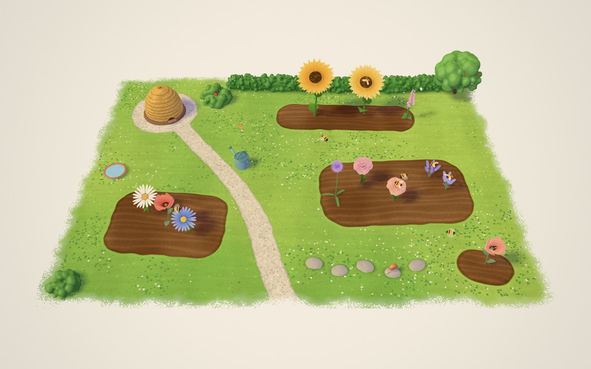
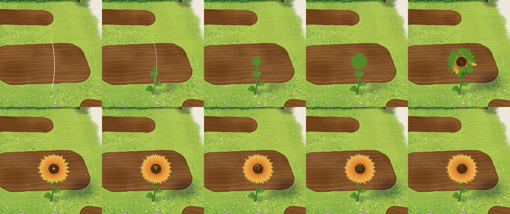
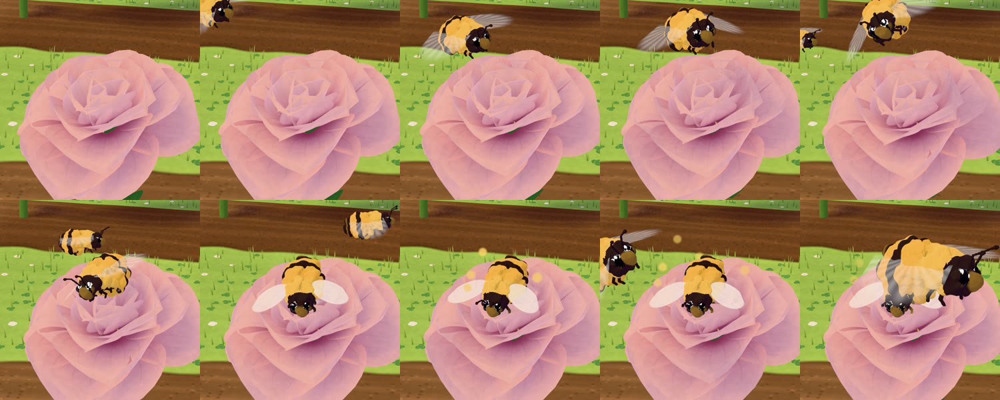
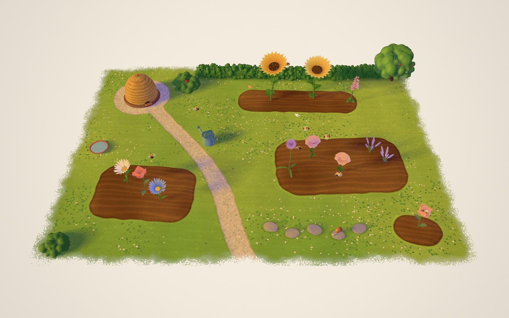
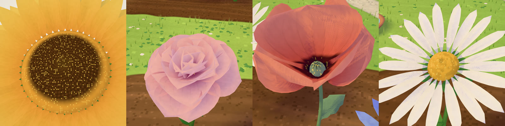

# HIVE

**Draw a flower on a painted garden and it grows along your line. The bees will find it.**

HIVE is a living storybook garden in the browser, and the sibling of [MEADOW](https://github.com/Mariaareadne1/meadow-interactive): the same hand, a new world. A hand-painted tile of cottage garden — raked beds, a lawn with clover, a gravel path, stepping stones, a clipped hedge, an apple tree and a straw skep — floats on a sheet of paper. Draw on a bed or the lawn: a stem grows up along your stroke, a bud swells and opens petal by petal, and a little colony of bees leaves the hive to visit it, comes home dusted with gold, and does a waggle dance on the landing board.



A line becomes a sunflower — the stem grows along the stroke, the bud swells, the petals are painted in:



| A bee lands and forages | Golden hour |
|---|---|
|  |  |



Demo (25 s, recorded by the app's own recorder): [`docs/media/hive-demo-720p.mp4`](docs/media/hive-demo-720p.mp4)

## Run it

```bash
npm install
npm run dev          # http://localhost:5376
```

Needs a browser with WebGL 2. Useful URLs:

| URL | What |
|---|---|
| `/` | Your saved garden, or a few first flowers on a first visit |
| `/?showcase` | A busy, reproducible garden at different depths |
| `/?empty` | A bare garden and a sleepy hive |
| `/?quality=low` | Fewer details, 2× MSAA, a lower pixel-ratio cap, a smaller shadow map |

## Drawing flowers

The stroke's lowest point is where it is planted; its height sets the stem's (within each kind's range); its shape chooses the kind. Plant in a bed or on the lawn — the cursor tells you where you can.

| Draw | Grows |
|---|---|
| A tall line (maybe with a loop on top) | Sunflower |
| A tall wobbly zig-zag | Foxglove |
| A spiral | Rose |
| A star, a spiky scribble | Daisy |
| A string of little loops, climbing | Lavender (a clump of spikes) |
| A clump of little loops | Allium |
| One round loop | Poppy |

When it is a close call, a **Make it a … instead** chip offers the runner-up for three seconds. **Plant: Auto · Sunflower · Rose · Daisy · Lavender · Poppy** in the toolbar forces a kind.

## Controls

| | Mouse / touch | Keys |
|---|---|---|
| Draw · Move tools | Toolbar | `D` · `V` |
| Plant choice | Toolbar | `0`–`5` |
| Select | Click a flower, a bee or the hive | `Tab` cycles |
| Move a flower or the hive | Drag it (it snaps back off plantable ground) | |
| Herd a bee | Drag a bee: it follows the pointer | |
| Turn | Scroll, or ↺ ↻ on the bar | `Q` / `E` |
| Flower | Water · Bloom/Close · Sway · Seed · Recolour · Call a bee | `W` `B` `C` |
| Bee | Follow (a dotted trail) · Visit… (then tap a flower) · Dance · Rest · Home | |
| Hive | Wake/Sleep · Swarm · Calm (smoke) · the honey jar | |
| Garden | Breeze · Rain shower · Day ↔ golden hour slider | |
| Duplicate / remove a flower | On its bar | `Shift D` / `Delete` |
| Undo / redo | Toolbar | `⌘Z` / `⇧⌘Z` |
| Save image | Camera button (PNG, up to 3840 px wide) | |
| Hide interface | Menu → Hide interface | `H`, `Esc` to bring back |
| Record a clip | Menu → Record 12-second clip (MP4/H.264 where supported, else WebM; includes the drawn line) | |

Gardens save automatically in the browser (a versioned document; untrusted files are validated) and export/import as JSON. Bees are simulation state and are recreated from the flowers.

## How it works (short version)

- **A painted tile in real 3D.** The garden is an analytic height function seen by a perspective camera from an elevated three-quarter view (tall screens turn a quarter turn). Planting raycasts exactly against it; flowers on the far side are genuinely smaller.
- **Gouache, in a shader.** The ground shader is generated from the same layout data the planting rules use: lawn washes and mowing stripes, raked umber beds with crumbs and a spade-cut edge, gravel, a ragged paper edge. One painted light with lavender shade; one sun shadow map for everything, with depth twins for things that move in their vertex shader.
- **Modelled flowers.** Petals are parametric surfaces (width profile, cup, curl, ruffle) built in a Web Worker. Each petal carries its own hinge and opening angles, so the vertex shader opens a bloom petal by petal with a soft overshoot, and closes it at dusk. Stems are generated on the GPU from a curve, so they grow along your stroke and sway without rebuilding.
- **The stroke is the stem.** The line is projected onto an upright plane through the planting point, facing the camera; the stem follows its rising part exactly.
- **A deterministic colony.** Bees run a fixed-step state machine (emerge, wander, approach, land, forage, take off, fly home, waggle dance, enter; plus peek, rest, swarm, herd) with arrival steering, noise lanes, loose separation and hard obstacle projection, so they never fly through stems, blooms or the hive. Nectar drains and refills; honey rises with deliveries.

The full write-up is in **[CASE_STUDY.md](CASE_STUDY.md)**; progress and known gaps in **[PROGRESS.md](PROGRESS.md)**.

## Development

```bash
npm run typecheck      # tsc
npm run lint           # eslint
npm test               # unit tests (vitest)
npm run test:e2e       # real-browser tests (Playwright, WebGL via Metal)
E2E_PROD=1 npm run test:e2e   # same, against the production build
npm run build          # dist/
```

QA scripts (need the dev server running) write to `artifacts/` (gitignored):

| Script | Output |
|---|---|
| `node scripts/shoot.mjs name [query] [w] [h] [waitMs]` | Full-frame screenshot |
| `node scripts/inspect.mjs name <flowerId\|hive\|bee> [dist] [lift] [query]` | Close-up from the app's own renderer |
| `node scripts/draw.mjs name <line\|spiral\|star\|loops\|clump\|circle\|zigzag> [x] [y] [frames]` | Draws a stroke and films the reveal frame by frame |
| `node scripts/actions.mjs` | Selections and actions, one frame each |
| `node scripts/perf.mjs [flowers]` | GPU-synced frame timings with machine load |
| `node scripts/demo.mjs 1600 900` | Scripted demo recorded through the app's recorder |
| `node scripts/gallery.mjs` | Regenerates the documentation stills |

MIT licensed. Everything is procedural; no third-party images or models.
